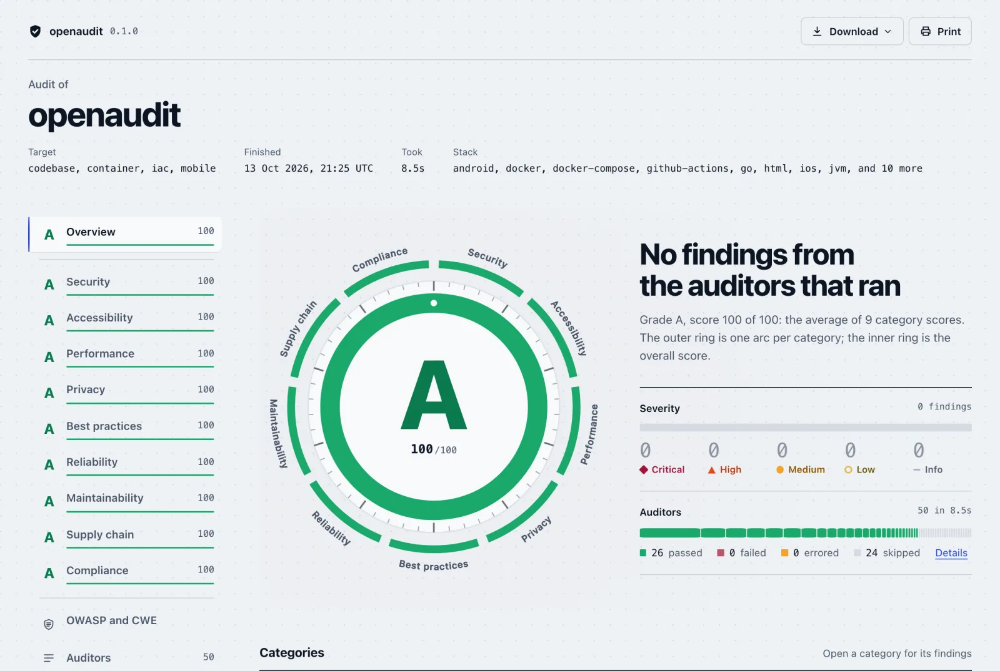

<div align="center">

# openaudit

**One scored audit of everything you ship.** Code, websites, running apps, APIs, containers, infrastructure, cloud accounts and mobile builds, from your terminal, your CI or your AI agent.

[](https://github.com/wezter96/openaudit/actions/workflows/ci.yml)
[](https://wezter96.github.io/openaudit/report/)
[](LICENSE)

<a href="https://wezter96.github.io/openaudit/report/">
<picture>
  <source media="(prefers-color-scheme: dark)" srcset="docs/assets/report-dark.webp">
  
</picture>
</a>

**[Open the interactive report](https://wezter96.github.io/openaudit/report/)**: openaudit's audit of this repository, rebuilt on every push.

</div>

openaudit runs 33 built-in auditors and wraps 50 established open-source scanners, linters and type checkers when they're installed. Ten agent **playbooks** cover the judgment-heavy work no rule can do, such as authorisation review, keyboard and screen-reader journeys, and privacy data flows. Everything lands in one report with a 0–100 score and an A–F grade per area.

- **One issue, one finding.** When gitleaks, TruffleHog and the built-in secret scan all find the same key, you get one finding that says who confirmed it, scored once.
- **A report people actually read.** A self-contained interactive HTML page with an overview, a tab per area and an OWASP Top 10 / CWE Top 25 view. It also comes as JSON, SARIF, Markdown and CSV.
- **Built for agents.** An MCP server, a JSON agent mode and playbooks that Claude Code, Cursor or Codex can run with their own tools.
- **Safe on hostile input.** Targets are treated as untrusted. Tools that would run project code are opt-in, and nothing builds or installs what it scans.
- **Free.** Every wrapped tool is free and open source. The only cost is tokens, if you choose to use the AI features.

## Quick start

```bash
bunx @openaudit/cli .                            # a codebase
bunx @openaudit/cli https://example.com          # a live site (add --browser for Playwright + axe-core)
bunx @openaudit/cli ./app-release.apk            # a mobile build (.apk, .aab, .ipa)
bunx @openaudit/cli image:nginx:1.27             # a container image
bunx @openaudit/cli cloud:aws --only cloud       # a live cloud account (Prowler)

bunx @openaudit/cli . -f html -o report          # write the interactive report to report/
bunx @openaudit/cli doctor                       # which optional scanners are installed
```

openaudit needs [Bun](https://bun.sh) 1.4 or newer. Scanners are optional: an auditor whose tool is missing is skipped with an install hint, and the rest of the audit runs normally. To run from source, see [Contributing](#contributing).

## What it audits

Every finding belongs to one of ten areas, and each area gets its own score and grade.

| Area | What openaudit looks for |
|---|---|
| **Security** | Leaked secrets (also in git history), injection, XSS and other risky code, weak crypto, disabled TLS or JWT checks, security headers, TLS, DNS and email spoofing protection, exposed files and APIs, container, IaC and cloud misconfiguration, risky mobile manifests, and optional dynamic scanning |
| **Accessibility** | WCAG checks in JSX, Vue, Svelte, HTML and CSS; axe-core and pa11y on rendered pages; Android layouts; keyboard and screen-reader journeys walked by an agent |
| **Performance** | Page weight, caching, compression, Core Web Vitals, Lighthouse, image and bundle size, container image size, mobile app size and native libraries |
| **SEO** | Titles and descriptions, crawlability, canonical URLs, sitemaps, structured data, broken links |
| **Privacy** | Trackers and cookies set before consent, analytics, ad and session-replay SDKs, personal data written to logs, mobile permissions |
| **Best practices** | Repository hygiene (README, licence, security policy, CI, lockfiles), Dockerfile and IaC lint, GitHub Actions hardening |
| **Reliability** | Type errors, broken pages and redirect chains, missing Kubernetes probes and limits |
| **Maintainability** | Linting, strict typing settings, duplication, dead code, deep nesting and oversized files |
| **Supply chain** | Known-vulnerable dependencies, unpinned versions and actions, OpenSSF Scorecard, licences, SBOMs, container image CVEs |
| **Compliance** | Licence obligations, cookie consent, OWASP Top 10 and CWE Top 25 mapping, CIS cloud benchmarks |

## Languages and ecosystems

| Language | Security | Dependencies | Types, lint and quality |
|---|---|---|---|
| JavaScript / TypeScript | built-in rules, Semgrep | npm, pnpm, Yarn and Bun lockfiles via OSV.dev; npm / pnpm / bun audit | tsc, oxlint (with its React, jsx-a11y and Next.js rules when the project uses them), Biome, ESLint\*, knip\*, strict `tsconfig` checks |
| Python | built-in rules, Semgrep, Bandit | `requirements*.txt`, `poetry.lock`; pip-audit | ruff, mypy\*, type-checker configuration |
| Go | built-in rules, Semgrep, gosec | `go.mod`; govulncheck\* | staticcheck, golangci-lint\* |
| Rust | Semgrep | `Cargo.lock`; cargo-audit | clippy\*, `[lints]` and `unsafe` policy checks |
| Ruby | built-in rules, Semgrep, Brakeman (Rails) | `Gemfile.lock` | |
| PHP | built-in rules, Semgrep | `composer.lock` | PHPStan |
| Java / Kotlin | built-in rules, Semgrep, mobsfscan (Android) | Maven and Gradle via osv-scanner and Trivy | PMD (Java) |
| C# / .NET | built-in rules, Semgrep | NuGet via osv-scanner and Trivy | |
| Swift / Objective-C | mobsfscan (iOS) | | |
| Shell | | | ShellCheck, `set -euo pipefail` checks |
| HTML, CSS, JSX, Vue, Svelte | accessibility and performance rules | | |

\* Opt-in: run it with `--only <id>`, e.g. `--only code.clippy`. The [next section](#what-it-checks-by-target) explains why some tools are opt-in.

Every language also gets secret scanning (built-in, gitleaks, TruffleHog), duplication checks (jscpd) and licence scanning. openaudit also reads these formats:
- **Containers:** Dockerfiles and Docker Compose.
- **Infrastructure:** Kubernetes manifests, Terraform, and GitHub Actions workflows.
- **API definitions:** OpenAPI / Swagger, AsyncAPI and GraphQL.
- **Mobile builds:** Android APK / AAB and iOS IPA.

## What it checks, by target

| Target | Built-in auditors | Wrapped tools (used when installed) |
|---|---|---|
| Codebase | secrets, static security (SAST), vulnerable dependencies (OSV.dev), API specs (OpenAPI, GraphQL), privacy (tracking SDKs, PII in logs), accessibility, performance, quality, language strictness, repo hygiene, dependency licence policy | **Secrets:** gitleaks, TruffleHog, git history\*. **SAST:** Semgrep, Bandit, gosec, Brakeman, mobsfscan. **Types and lint:** tsc, oxlint, Biome, ruff, staticcheck, PHPStan, PMD, ShellCheck, ESLint\*, clippy\*, mypy\*, golangci-lint\*. **APIs:** Spectral. **Dependencies:** osv-scanner, Trivy, npm/pnpm/bun audit, pip-audit, cargo-audit, govulncheck\*, Grype\*. **Supply chain:** OpenSSF Scorecard, GuardDog (malicious packages)\*, Syft licences\*. **Quality and licences:** jscpd, knip\*, ScanCode\*. **AI review:** deepsec\* |
| URL | security headers, TLS, DNS and email (SPF, DMARC, CAA, MTA-STS, subdomain takeover), exposed APIs (OpenAPI, GraphQL introspection), SEO, accessibility, performance, reliability, exposed files, privacy and trackers | Lighthouse, pa11y, OWASP ZAP baseline\*, ZAP active scan\* (allow-listed hosts only), testssl.sh\* |
| Running web app (`--browser`) | axe-core in Chromium, console errors, failed and mixed-content requests, Core Web Vitals, trackers and cookies set before consent | |
| Containers | Dockerfile, Compose, image (root user, age, size, secrets) | Trivy, hadolint, Dockle\* |
| Infrastructure as code | GitHub Actions, Kubernetes, Terraform | zizmor, actionlint, kube-linter, kubeconform, TFLint, Checkov, KICS\*, Kubescape\* |
| Mobile | Android manifest (incl. binary AXML in APKs), iOS Info.plist (incl. binary plists in IPAs), embedded secrets, bundled SDK versions checked against OSV, layout accessibility, size and performance | |
| Cloud (`cloud:aws`, `azure`, `gcp`, `kubernetes`) | | Prowler\* |

\* Opt-in, because it's slow, noisy, sends more traffic to the target, spends tokens, or runs project code. Select it with `--only <id>`, e.g. `--only code.clippy` or `--only agent.deepsec`.

The opt-in `code.dependency-health` auditor looks your pinned dependencies up on [deps.dev](https://deps.dev) and flags deprecated packages, yanked releases, dependencies whose source repository is archived, and direct dependencies with no release in years.

`bunx @openaudit/cli list` shows every auditor and playbook. The [architecture page](https://wezter96.github.io/openaudit/architecture.html) maps every auditor to the targets and areas it covers.

## The report

Every run produces one report, in whichever formats you ask for: `-f terminal,json,sarif,markdown,html`.

- **Score and grade.** Each area scores 0–100 from the severity of its findings; info findings never lower a score. The overall score is the average of the areas that were actually examined. Skipped auditors are listed with the reason, so a clean result never hides a check that didn't run.
- **Interactive HTML.** One self-contained file with no external requests, so it opens offline and can be attached to a CI run or an email. It has an overview, a tab per area with filters and search, an auditors tab, and OWASP Top 10 / CWE Top 25 groupings. It works with JavaScript off, prints cleanly, and lets readers download the same audit as JSON, SARIF, Markdown or CSV. Shared reports name the project folder, never your local path.
- **Stable fingerprints.** Each finding has a fingerprint that baselines, suppressions and `compare_reports` rely on.
- **Diff mode.** `--diff origin/main` keeps only findings in files changed since that ref, for pull requests.

## With AI agents

Some audits need judgment rather than patterns. openaudit is built so agents can drive it end to end:

- **MCP server.** `claude mcp add openaudit -- bunx @openaudit/cli mcp` (or the equivalent `mcp.json` in Cursor or VS Code) gives an agent `run_audit`, `get_finding`, `compare_reports` and more, plus the playbook tools `list_playbooks`, `get_playbook` and `submit_findings`. Your agent does the review with its own tools, and its findings merge into the same scored report. No extra API key is needed.
- **Headless agentic auditors.** `openaudit . --agentic` runs the playbooks through the Claude Agent SDK. The agent gets read-only tools, confined to the project and the target origin. It uses `ANTHROPIC_API_KEY` or an existing Claude Code login.
- **AI triage.** `--ai` turns the findings into a prioritised fix plan. Only finding metadata is sent, never file contents.
- **Agent mode CLI.** `--json` prints a single JSON report to stdout, and `openaudit schema` gives its JSON Schema.
- **Skill.** [`skills/openaudit/SKILL.md`](skills/openaudit/SKILL.md) teaches an agent the loop: baseline, triage, playbooks, fix, then verify with `compare_reports`.

Details are in [`apps/cli/README.md`](apps/cli/README.md) (CLI, CI, MCP setup) and [`packages/agent/README.md`](packages/agent/README.md) (playbooks, data handling).

## In CI

The repository is also a GitHub Action. On pull requests it reports only findings in changed files, uploads SARIF to code scanning, attaches the reports as an artifact and writes a job summary:

```yaml
permissions:
  contents: read
  security-events: write

steps:
  - uses: actions/checkout@v7
    with:
      fetch-depth: 0 # diff mode compares against the base branch
  - uses: wezter96/openaudit@main # pin to a commit SHA in real use
    with:
      fail-on: high
```

Inputs: `target`, `fail-on`, `diff` (defaults to the PR base; `none` audits everything), `only`, `exclude`, `config`, `upload-sarif`, `upload-report`. Outputs: `score`, `grade`, `report-dir`.

Elsewhere, run the CLI: `bunx @openaudit/cli . --diff origin/main -f html,sarif -o openaudit-report --fail-on high`. `--fail-on <severity>` sets the exit code, and `--baseline previous.json` reports only findings that are new since an earlier run. This repository audits itself in [`ci.yml`](.github/workflows/ci.yml) and publishes the result with [`pages.yml`](.github/workflows/pages.yml).

## Configuration

`bunx @openaudit/cli init` writes an `openaudit.config.json` with suppressions (`ignore.rules`, `ignore.paths`, `ignore.fingerprints`), auditor selection and per-auditor settings, such as a dependency licence policy (`settings["code.licenses"]` with `deny` and `allow` lists of SPDX ids). Every report discloses how many findings each config or baseline suppressed.

A config found inside the audited target is written by whoever controls the target, so it can only narrow an audit or add its own licence policy. It cannot enable opt-in auditors, add credentials or switch off the `--fail-on` gate. Settings like that come only from flags or from a file passed with `--config <path>`. See [`apps/cli/README.md`](apps/cli/README.md#configuration).

## Safety

openaudit treats every target as hostile:
- **Files:** reads are confined to the project root and never follow symlinks out of it.
- **HTTP:** user-supplied headers go only to the exact target origin, and credentials are stripped on cross-origin redirects.
- **Agents:** openaudit's own agents have no shell, and the browser is held to the target origin at the network layer. deepsec's reviewer does get a sandboxed shell, which is why it is opt-in.
- **Wrapped tools:** tools never build or install the target. They run from temporary directories so project config can't redirect them (pnpm hook files, pa11y config, oxlint JS plugins, Spectral custom functions). Linters whose config is code (ESLint, clippy, mypy, golangci-lint) are opt-in.
- **Git:** every git call overrides `core.fsmonitor` and hooks, diffs compare commits rather than the working tree, and history scans run on a fresh mirror clone.
- **Active scanning:** the ZAP active scan runs only against hosts allow-listed in a trusted `--config`.
- **Hosted URL-audit API:** connections are pinned to DNS-validated public IPs.
- **Evidence:** secrets in evidence are redacted.

URL auditors send only low-volume GET/HEAD requests; the opt-in ZAP scans are the exception. **Only audit systems you own or are authorised to test.** Report vulnerabilities privately as described in [SECURITY.md](SECURITY.md).

## How it works

```
 CLI · MCP server · HTTP API · GitHub Action
                    │
                    ▼
 target detection ─► engine: select auditors, run them in parallel, isolate failures
                    │
        built-in · wrapped scanners · agent playbooks
                    │
                    ▼
 merge duplicates ─► score each area ─► terminal · JSON · SARIF · Markdown · HTML
```

| Path | What |
|---|---|
| `packages/core` | Report model (the public contract), engine, cross-tool correlation, diff mode, target detection, reporters |
| `packages/auditors` | Built-in and external-tool auditors: `codebase`, `web`, `infra`, `mobile`, `cloud` |
| `packages/agent` | Playbooks, agentic auditors (Claude Agent SDK), AI insights |
| `packages/mcp` | MCP server |
| `apps/cli` | The `openaudit` binary |
| `apps/server`, `packages/api` | Hono + oRPC HTTP API (`/api-reference` for OpenAPI docs) |
| `apps/web` | Website: landing page, live URL audit, report viewer, docs |
| `docs/` | Architecture page (`bun docs/architecture.ts` regenerates it) and the GitHub Pages landing page |

## Contributing

Contributions are welcome: new auditors, better rules, fewer false positives, docs. [CONTRIBUTING.md](CONTRIBUTING.md) covers setup, the auditor contract, the security rules every wrapper must follow, and the pull request checklist. Please read the [Code of Conduct](CODE_OF_CONDUCT.md) first.

```bash
bun install
bun run test && bun run check-types && bunx biome ci .
bun run audit -- .        # run the CLI from source
```

## Community

openaudit is shared with [OpenSverige](https://opensverige.se/), Sweden's open community for people building AI agents and MCP servers. Come show what you've audited, or tell us what openaudit missed.

## License

[MIT](LICENSE). The scanners openaudit wraps keep their own licences and are installed separately.

---

<p align="center">Brought to you by the team behind <a href="https://sokhem.se/">SökHem</a> · <a href="https://sokhem.se/">sökhem.se</a></p>
